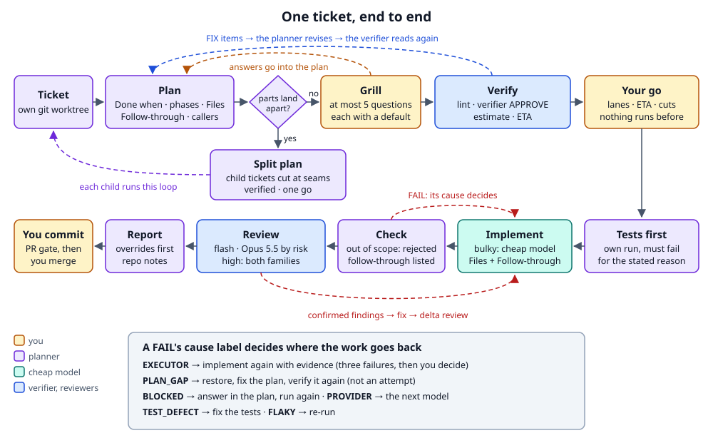

<p align="center"></p>

<p align="center">
<a href="https://github.com/bqp007/concord-agent-harness/actions/workflows/ci.yml"></a>
<a href="LICENSE"></a>

</p>

**Concord keeps you in control of AI coding agents.**

Agents now write code faster than people can read it. Review quietly turns into approval, and after a few weeks nobody can say why the system is shaped the way it is. Concord spends your limited attention where it matters. A strong model plans each change, writes the tests and the small fixes, and checks every result. Cheap models write the bulky code inside a fixed file scope. An independent reviewer checks each change once, at its risk level. You approve the plan and commit the result. A small standard-library Python dispatcher enforces the arrangement (file scope, tests that must fail first, review tiers, attempt caps, a ledger of verdicts with their causes), so it still holds on a busy day.

In its first ten days of daily use it recorded 293 verdicts; 82% of the phases given to a cheap model passed on the first attempt, for US$7.50 of model spend in total.

**Status:** a working harness, used daily and actively developed. New versions ship through the plugin marketplace and this repository; see [Install](#install) for how to update.

<p align="center"></p>

## Contents

- [How it works](#how-it-works)
- [Install](#install)
- [Try it without credentials](#try-it-without-credentials)
- [Run a ticket](#run-a-ticket)
- [Components](#components)
- [Safety](#safety)
- [Results](#results)
- [How it compares](#how-it-compares)
- [Citation](#citation)
- [Contributing](#contributing)
- [License](#license)

## How it works

1. **Plan.** In Claude Code, `/concord:plan-then-delegate <task>`. The planner reads the code, the spec, any `Cases:` file and the skills, then writes an early `PLAN_<ticket>.md`: done when, ship, design, test plan, conflicts, open questions, and per phase the executor, risk, files, steps, `Size:` and `After:`. A grill follows: at most five blocking questions with defaults. A verifier agent (`concord:plan-verifier`) reads the code itself and answers CUT, MERGE, PARALLELIZE, DIRECT and FIX items. `concord.py --estimate` prints the lanes, the critical path and the ETA, and `concord.py --lint` checks each delegated phase. You give one go/no-go on the lanes, the ETA and the cuts.
2. **Tests first.** The planner writes tests that fail on the current code. The dispatcher refuses to start a delegated phase whose acceptance already passes.
3. **Delegate.** The planner writes changes of up to about 60 lines itself; `concord.py free-deepseek-flash <phase>` runs a bulky phase on a cheap model, free tier first. On OpenCode, edits outside the phase's `Files:` are refused. Phases run in parallel lanes. A lock covers a set of files, not a checkout, so phases with disjoint `Files:` run in one worktree at once; a shared file gets a fork.
4. **Check and review.** The dispatcher re-runs the acceptance commands and writes an evidence report: scope, the red run, acceptance after the run. The planner reads its blocking lines, trusts its acceptance re-run and reads the diff. A review round is a full review at the risk tier, fixes, a cheap delta review, then a full review on the new head. It stops at 0 BLOCKER and 0 HIGH; a pull request gets at most three full review rounds (one per head), and a fourth needs `--user-approved`. A MEDIUM is fixed only in a real flow; the rest go to the DAT.
5. **Record.** `concord.py --report` writes the test report from recorded data and stops the drift clock: phases, test plan, test lines, review rounds, open items for the DAT, time against the ETA. Every FAIL carries a cause (EXECUTOR, PLAN_GAP, TEST_DEFECT, FLAKY, PROVIDER, BLOCKED). Three executor failures stop a phase. Runs and verdicts go to `~/.claude/concord/runs.jsonl`; findings to a ledger.
6. **KB update and commit.** The session replaces the repo-notes lines the ticket changed, runs `KB command:` when set, and merges the approved case diff into the `Cases:` file. You commit. Concord never commits or pushes.

[docs/WORKFLOW.md](docs/WORKFLOW.md) walks through one ticket from plan to commit.

## Install

```bash
git clone https://github.com/bqp007/concord-agent-harness.git && cd concord-agent-harness
bash install.sh --dry-run   # shows every link, copy, keep and backup; writes nothing
bash install.sh             # the default: links the commands and agents into ~/.claude, installs the dispatcher, then runs its twenty-one suites
```

The default install symlinks the commands and agents into `~/.claude` and edits your live setup: it writes the Concord rules into `~/.claude/CLAUDE.md` between `<!-- concord:begin -->` and `<!-- concord:end -->`, and adds any missing keys to `~/.claude/settings.json`. It backs up each file it changes first and leaves everything outside the markers untouched.

For the plugin marketplace layout instead, `bash install.sh --plugin` installs the dispatcher and prints the commands to run in Claude Code:

```text
/plugin marketplace add bqp007/concord-agent-harness
/plugin install concord@concord
```

To update, run `git pull` then `bash install.sh` in the clone, and restart Claude Code.

Prose style lives in `~/.claude/concord/style.conf` (`prose = lean`, the default, selects lean STE, or write a sentence of your own). Plans carry a tier (S, M or L), a drift brake stops a run that outgrows its plan, and a plan verifier prunes each plan first: [docs/WORKFLOW.md](docs/WORKFLOW.md#size-drift-and-verification). Requirements (bash, git, Python 3.9+, Claude Code, OpenCode for the cheap executors), executor configuration and other harnesses such as Codex: [docs/SETUP.md](docs/SETUP.md).

## Try it without credentials

```bash
bash scripts/demo.sh          # add --keep to inspect the run folders afterwards
```

The demo runs the whole loop in under a minute inside a temporary folder, with a scripted executor instead of a model: no network, no account, nothing written outside that folder. A toy repository has a bug and a failing test. The first attempt fixes the bug but also edits a file outside the phase's scope, so the report flags it and the phase fails with cause EXECUTOR. The second attempt stays in scope: the red run, the passing acceptance, a review and the PASS verdict follow. The plan it uses is [examples/PLAN_example.md](examples/PLAN_example.md).

## Run a ticket

```bash
python3 ~/.claude/concord/wt.py new <TICKET>     # one git worktree per ticket
# in Claude Code, inside the worktree:
#   /concord:plan-then-delegate <what you want done>   plan, open questions, your approval, then every phase
#   /concord:delegate <phase|all>                      run planned phases on their executors and check them
python3 ~/.claude/concord/concord.py --pr-status <PR>   # REVIEWED once the PR's current head has its review
```

Exit codes: 2 usage, plan or lock; 3 a Claude model on the run path; 4 unknown model; 5 billing guard; 6 acceptance already green (red run); 7 PASS refused because acceptance files changed; 8 attempt cap; 9 a provider refused a review (nothing recorded); 124 timeout. `concord.py --help` lists every command.

## Components

| Path | Installs to | What it is |
|---|---|---|
| `concord/concord.py` | `~/.claude/concord/` | the dispatcher: runs one plan phase on one executor, reports the evidence, reviews it, records the verdict |
| `concord/wt.py` | `~/.claude/concord/` | one git worktree per ticket; links large untracked folders from the main checkout |
| `concord/CONTRACT.md` | `~/.claude/concord/` | the contract every executor reads first: twelve rules and the report format |
| `concord/PLAN_TEMPLATE.md` | `~/.claude/concord/` | the plan format |
| `concord/REVIEW.md` | `~/.claude/concord/` | the review task: three closed questions, severities, the REVIEW-JSON format |
| `concord/*.conf` | `~/.claude/concord/` (kept if present) | model registry and billing routes, harness settings, worktree links |
| `concord/tests/` | `~/.claude/concord/tests/` | twenty-one regression suites; `run_all.sh` runs them in parallel with a fake HOME |
| `adapters/claude-code/` | Claude Code, as the `concord` plugin | `/concord:plan-then-delegate`, `/concord:delegate`, `/concord:rules-review` and the implementer and reviewer agents; also four hook rules (`install.sh --repo`), and the CLAUDE.md rules block and settings keys the installer writes |
| `scripts/demo.sh`, `examples/` | nowhere | the credential-free demo and its plan |
| `tests/` | nowhere | the repository's own checks: layout, budgets, install, docs, demo |
| `docs/` | nowhere | setup, the workflow, the comparison, figures |

## Safety

- **Enforced by the dispatcher:** the red run; the out-of-scope report, and refusal of out-of-scope edits on OpenCode; a PASS is refused when acceptance files changed during the run; the attempt cap; the review tier at the PR gate; the billing guard (Claude models never go to another harness).
- **Advisory:** the executor contract and the hook rules are instructions a model can ignore. Scope is enforced only on OpenCode, and only for its edit tools, not for shell redirection. The backup of in-scope files taken before every run is the real safety net.
- **Network:** the dispatcher's only request of its own is `--models --verify`, which fetches OpenCode's public model catalogs. Executors and reviewers reach their model providers through their harness; `--review-pr` uses the GitHub CLI.
- **Git:** Concord never commits, pushes or changes branches in your checkout; `wt.py` creates and removes worktrees only when you ask.
- **Not a sandbox:** agents run shell commands as your user. Known gaps, recommendations and how to report a vulnerability: [SECURITY.md](SECURITY.md).

## Results

One developer used Concord daily from 11 to 20 October 2026 while shipping a production mobile security product. The ledger it shipped with records:

| Measure | Value |
|---|---|
| Plans | 42, across 30 checkouts |
| Recorded verdicts | 293: 258 PASS, 35 FAIL |
| Failure causes | 19 plan gaps, 7 executor, 5 flaky, 4 test defects |
| Executor runs passing | 107 of 137 |
| Executor phases passing on the first attempt | 91 of 111 (82%) |
| Executor spend at list prices | US$7.50 in total, median US$0.02 per run |

Most failures were plan gaps, not executor mistakes, which is why the planner writes the tests and every delegated phase is linted before it runs. This is an exploratory case study by one person who also assigned the failure causes, not a controlled experiment.

## How it compares

[docs/COMPARISON.md](docs/COMPARISON.md) sets Concord beside the workflows it learned from (ECC, agentic-sdlc, agent-protocols, Claude Code's own plan mode, subagents and hooks, Harness², MetaGPT, ChatDev and recent harness-evolution research): what it adopted, what it skipped on purpose and what it still lacks.

## Citation

If you use Concord, please cite it. GitHub's "Cite this repository" button reads [CITATION.cff](CITATION.cff).

```bibtex
@software{pham2026concord,
  author = {Pham, Bao Q.},
  title  = {Concord: a governed workflow for AI coding agents},
  year   = {2026},
  url    = {https://github.com/bqp007/concord-agent-harness}
}
```

## Contributing

Changes to Concord follow Concord: a plan, tests first, an independent review, line budgets. See [CONTRIBUTING.md](CONTRIBUTING.md).

## License

MIT, see [LICENSE](LICENSE). The papers cited in the documentation belong to their authors.

Concord is an independent project by Bao Q. Pham. Product and model names (such as Claude, Claude Code, OpenCode and DeepSeek) are used only to describe compatibility; they are trademarks of their owners, who do not sponsor or endorse this project.
