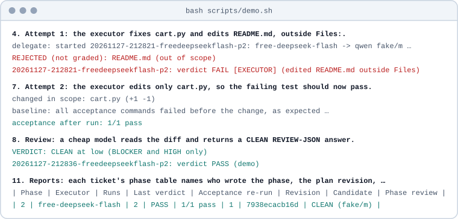
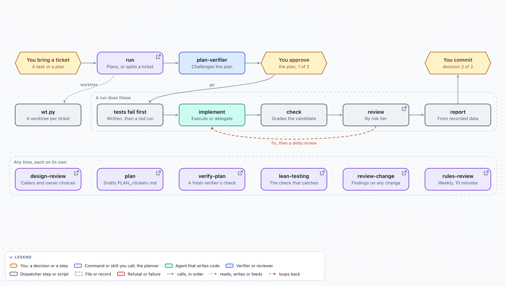

<h3 align="center">
  <picture><source media="(prefers-color-scheme: dark)" srcset="assets/concord-wordmark-dark.svg"></picture><br>
  A governed workflow for AI coding agents
</h3>

<p align="center">
  <a href="https://github.com/bqp007/concord-agent-harness/actions/workflows/ci.yml"></a>
  <a href="https://bqp007.github.io/concord-agent-harness/"></a>
  <a href="docs/WORKFLOW.md"></a>
  <a href="#results"></a>
  <a href="LICENSE"></a>
  
</p>

<p align="center">
  <a href="#try-it-without-credentials"><picture><source media="(prefers-color-scheme: dark)" srcset="docs/assets/readme/demo-dark.svg"></picture></a>
</p>

A **harness** is the system around a model that lets it act as an agent: prompts, tools, skills, orchestration. **Governance** is what keeps a person accountable for what the agents ship: who decides, what counts as evidence, and what a verdict means.

Concord is a governance layer for coding agents. It separates three roles that one agent session would otherwise hold:

* **Who decides.** You settle the plan's open questions, approve it and commit.
* **Who writes.** A strong model plans and writes tests and small changes; low-cost models write bulky code inside each phase's declared files.
* **Who judges.** A standard-library Python dispatcher runs the acceptance commands and records verdicts with their causes; a fresh reviewer reads each change at its risk tier.

<p align="center"><a href="https://bqp007.github.io/concord-agent-harness/map/"><picture><source media="(prefers-color-scheme: dark)" srcset="docs/figures/fig2-loop-dark.svg"></picture></a></p>
<p align="center">Online: the <a href="https://bqp007.github.io/concord-agent-harness/">explainer</a> (the loop, step by step) and the <a href="https://bqp007.github.io/concord-agent-harness/map/">interactive map</a> (every command, skill and record).</p>

Over 46 days of production use by one developer, Concord recorded 1,315 verdicts; 84% of phases given to a low-cost model passed on the first attempt.

## Contents

[Principles](#principles), [How it differs](#how-it-differs), [How it works](#how-it-works), [Install](#install), [Try it](#try-it-without-credentials), [Run a ticket](#run-a-ticket), [Components](#components), [Safety](#safety-and-limits), [Results](#results)

## Principles

Each promise is kept by code up to its limit. A test asserts each refusal in the table: `guards_test.sh` for P1 and P6, `delegate_test.sh` and `testquality_test.sh` for P2, `papers_test.sh` for P3, P4 and P7, and `prgate_test.sh` for P5, all in `concord/tests/` ([exit codes](docs/REFERENCE.md#exit-codes)).

| Promise | Mechanism | Refusal you can reproduce | Limit |
|---|---|---|---|
| **P1.** Runs follow the approved plan text | A recorded APPROVE binds to the text's hash | An edited plan's run exits 11, even with `--user-approved` | The code checks only that a recorded APPROVE quotes the text's hash, not who wrote it, and it neither records nor checks your go/no-go |
| **P2.** Tests fail before the code exists | The red run: acceptance runs on the untouched tree first | A delegated phase whose tests already pass exits 6 | A session run (`--begin`) only warns |
| **P3.** A PASS rests on recorded results | The dispatcher re-runs the acceptance commands on a copy of the run's result | An unexpected or missing result: PASS exits 7 | A forced PASS, or one with no acceptance command, is listed first; weak tests pass weak code |
| **P4.** Each phase declares its files first | A change outside `Files:` and `Follow-through:` rejects the run | `REJECTED (not graded)`; PASS exits 7 | Only OpenCode refuses the edit while the run is in progress; on the other executors the edit is found after the run |
| **P5.** Review rises with risk | Each file in a pull request needs its riskiest run's tier; high needs two model families | `--pr-status` exits 1 until every file is covered, no BLOCKER, HIGH or clause FAIL open | A review covers only what its reviewer read, at the rank of the reviewer name the caller records |
| **P6.** Every run is recorded; overrides come first | Ledgers keep every verdict, cause and finding, and the report's first section lists every override, such as a forced PASS | `--report` exits 2 while a run lacks a verdict | The planner alone assigns the causes; the report is a status export, not a check that every phase passed |
| **P7.** You commit | Concord never commits to a branch (the only commit object it writes is the snapshot `wt.py fork` makes with `git commit-tree`, which no branch or ref points to); any index change or moved HEAD rejects a run | A file staged after the run began makes `--grade` and a later PASS exit 7 and names the file | No code stops the planning session from committing; that rule is an instruction |

## How it differs

Of the systems compared, only Concord binds an approval to the hash of the plan text its verifier read and re-runs the acceptance commands itself. Its dispatcher refuses a run whose plan text has no recorded APPROVE, and a PASS unless every acceptance command it re-ran gave the expected result. Source: [docs/COMPARISON.md](docs/COMPARISON.md).

| Kind of harness | What you approve | What a PASS rests on | Who reviews | What is recorded |
|---|---|---|---|---|
| Plan mode and subagents (Claude Code) | Permission prompts and the plan | Nothing built in | Optional | Nothing built in |
| Role-play frameworks (MetaGPT, ChatDev) | Nothing during a run | Unit tests or execution feedback | Author or same model | Typed documents or chat chains |
| Workflow plugins (ECC, agentic-sdlc) | Prompt-text gates, advisory sign-offs | Reports quoting commands and exit codes | A separate agent | Gate reports, persisted state |
| Self-improving harnesses (Harness²) | Nothing during a run | Behavioral contrasts | Automated selector or judge | Rollout ledgers |
| Concord | Every plan; the commit | Acceptance results the dispatcher re-ran | A fresh agent by risk tier; two families at high | Every run, verdict, cause and finding |

## How it works

1. **Plan.** The planner reads the code, writes `PLAN_<ticket>.md` and asks at most five questions.
2. **Verify and go.** A verifier checks the plan against the code; you give the go.
3. **Tests first.** Failing tests are written and checked to fail for the stated reason.
4. **Implement.** The planner writes each phase, or low-cost models write bulky ones in parallel.
5. **Check and review.** The dispatcher grades each run; a reviewer reads each change at its risk tier.
6. **Report and commit.** The report lists overrides first; you read it and commit.

Details: [docs/WORKFLOW.md](docs/WORKFLOW.md).

<p align="center"><a href="https://bqp007.github.io/concord-agent-harness/map/"><picture><source media="(prefers-color-scheme: dark)" srcset="docs/assets/readme/map-dark.png"></picture></a></p>

## Install

```bash
git clone https://github.com/bqp007/concord-agent-harness.git && cd concord-agent-harness
bash install.sh --dry-run   # previews; writes nothing
bash install.sh
```

The install backs up and edits `~/.claude/CLAUDE.md` and `~/.claude/settings.json`, letting `gh`, `git push`, `git fetch`, `git pull` and `git clone` run outside Claude Code's sandbox in every project. It needs bash, git, Python 3.9+ and Claude Code; `--plugin` uses the marketplace instead. To update: `git pull`, then `bash install.sh` (or `bash install.sh --plugin` and the two `claude plugin` update commands for a marketplace install), then restart Claude Code ([setup](docs/SETUP.md#upgrade)).

## Try it without credentials

```bash
bash scripts/demo.sh
```

The demo runs both modes in about a minute with a scripted executor in a temporary folder: no network, no account. In delegate mode the first attempt edits outside its files and fails with cause EXECUTOR; the second passes. Execute mode follows ([walk-through](docs/SETUP.md#the-demo)).

## Run a ticket

| You type | What happens |
|---|---|
| `python3 ~/.claude/concord/wt.py new <TICKET>` | A worktree and branch for the ticket |
| `/concord:run delegate <task>` (or `execute`) in Claude Code | Plan, questions, verifier, your go; each phase written, checked, reviewed |
| `git commit`, after reading the report | The report lists every override first |

Commands, exit codes, causes: [docs/REFERENCE.md](docs/REFERENCE.md). The five skills also work alone ([names](docs/SETUP.md#names)).

## Components

<p align="center"><picture><source media="(prefers-color-scheme: dark)" srcset="docs/figures/fig0-concord-layers-dark.svg"></picture></p>

| Path | What it is |
|---|---|
| `concord/concord.py` | The dispatcher |
| `concord/wt.py` | One git worktree per ticket |
| `concord/*.md`, `*.conf` | Executor contract, review task, plan format, model registry, settings |
| `adapters/claude-code/` | The plugin: command, skills, agents, hook rules |
| `concord/tests/`, `tests/` | Suites and repository checks |

Full table: [docs/REFERENCE.md](docs/REFERENCE.md#components).

## Safety and limits

- **Enforced by the dispatcher:** plan approval, red run, PASS rule, scope rejection, review tiers, a billing guard on model names, an executor environment allow-list that never passes Claude or Anthropic variables.
- **Advisory:** the executor contract and hook rules.
- **Not a sandbox:** agents run commands as your user; the red run and the acceptance commands run before and after each run, unsandboxed, with your environment ([SECURITY.md](SECURITY.md)).

The executors are OpenCode and the `pi` CLI; the native `qwen`, `dsh` and `kimi` adapters also ship but are untested in this release. The demo needs no executor. In execute mode the planning session writes every phase, so an executor is needed only for the reviews that run on a cheap flash model: the low-tier review, and the second review from another model family that a high-risk change needs ([setup](docs/SETUP.md#executors)).

## Results

One developer's ledger, 11 October to 25 November 2026, shipping a production mobile security product:

| Measure | Value |
|---|---|
| Plans | 130, across 119 tickets |
| Recorded verdicts | 1,315: 1,156 PASS, 159 FAIL |
| Failure causes | 72 executor, 51 plan gaps, 18 blocked, 13 test defects, 5 flaky |
| Executor runs passing | 738 of 866 (85%) |
| Executor phases passing on the first attempt | 585 of 696 (84%) |
| Executor spend at list prices, 11 to 20 October | US$7.50 for 137 runs, median US$0.02 per run |

Method: the planner assigned each failure cause. The counts leave out 111 runs that a model provider refused. The spend row covers 11 to 20 October because the `pi` executor, which ran most later phases, records no per-run price. [docs/PILOT.md](docs/PILOT.md) designs a paired comparison of the full loop with a lighter path on matched tickets.

## Citation

See also [CITATION.cff](CITATION.cff).

```bibtex
@software{pham2026concord,
  author = {Pham, Bao Q.},
  title  = {Concord: a governed workflow for AI coding agents},
  year   = {2026},
  url    = {https://github.com/bqp007/concord-agent-harness}
}
```

## Contributing

Changes need a plain plan, failing tests first, an independent review and a maintainer's acceptance: [CONTRIBUTING.md](CONTRIBUTING.md).

## License

MIT, see [LICENSE](LICENSE). The papers cited in the documentation belong to their authors.

## Disclaimer

Concord is an independent project by Bao Q. Pham. Product and model names (such as Claude, Claude Code, OpenCode and DeepSeek) are used only to describe compatibility; they are trademarks of their owners, who do not sponsor or endorse this project.
