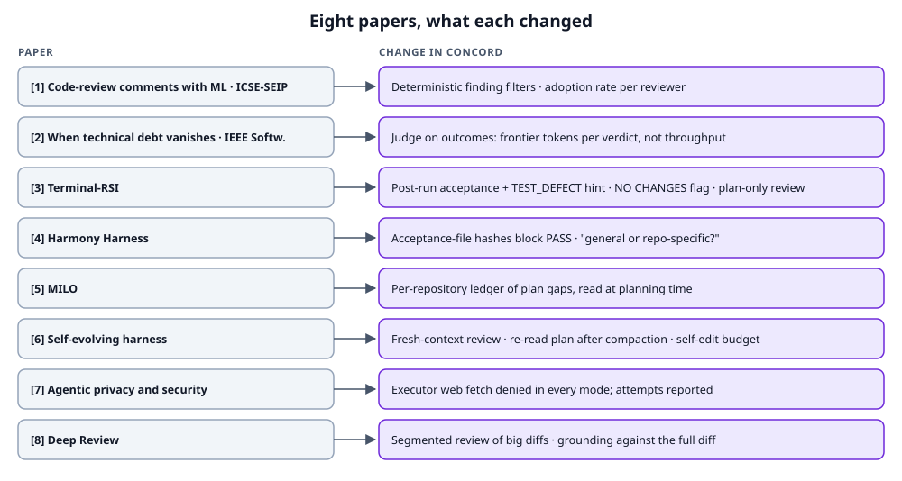

# How Concord compares

Concord grew out of reading other workflows and papers, keeping what held up in daily use. This page sets it beside the systems it learned from, each read against the same questions: the unit of work, who plans and who writes code, where a human decides, what evidence a run leaves, who reviews, which rules code enforces rather than a prompt requests, isolation, learning, cost and results. The facts come from each project's source or paper as read on 21 October 2026; the papers in the research section were read, or read again, on 28 November 2026. Only Concord itself was run.

<picture><source media="(prefers-color-scheme: dark)" srcset="figures/fig0-concord-layers-dark.svg"></picture>

## At a glance

| | Where a human decides | Evidence a run must leave | Who reviews | Enforced by code, not by a prompt |
|---|---|---|---|---|
| Concord | approves every plan; commits | the dispatcher's report (scope, red run, acceptance re-run) and a verdict with a cause; a PASS only on the expected acceptance results | a fresh agent at the change's risk tier, then a cheap delta review of each fix | plan approval bound to the hash of the text the verifier read, red run, a lock on each run's files, the scope check, acceptance results on the graded candidate tree, pinned grading files, PR review tier and finding closure, a billing guard on model names; edit scope and no web fetch on OpenCode |
| ECC | `/plan` asks for approval before code; the orchestration pipeline adds a gate before commit (both prompt text) | test-first and verification skills write reports quoting real commands | a separate reviewer agent; cross-provider and adversarial reviews on request | hooks that block `--no-verify`, protect config files and gate a first edit |
| agentic-sdlc | three sign-offs (advisory); git commands ask first | gate reports quoting command, exit code and runner summary | a separate reviewer agent on the session's model | a hook that asks before commit, tag, push and publish (it fails open by design); strike counters in a state script |
| agent-protocols | none required | checklists inside the skills | an optional persona | nothing |
| Claude Code built-ins | permission prompts; plan approval | none built in | optional: subagents, `/code-review`, a second session | permission rules, hooks, plan mode's edit block, an OS sandbox for the shell, worktrees |
| Harness² | none during a run | a lesson enters the library only when execution contrasts support it | an anonymized selector; on one benchmark the judge and the editor are the same model | grader verdicts kept out of the improver's context; turn and time caps |
| MetaGPT | none during a run | unit tests, three retries | the author checks its own work | stage order, retry cap |
| ChatDev | none during a run | execution feedback and a static review | the same model in a reviewer role | phase order, round cap |

## Claude Code, the host

Concord runs inside Claude Code and leans on its real enforcement: subagents for reviewers with a fresh context, hooks (through the hookify plugin) for four reminder rules that catch common spellings of destructive git commands, recursive deletes outside a scratch folder and writes to a shared `PLAN.md`, and git worktrees for one ticket per checkout. What Claude Code does not provide is a lifecycle around a change: no plan format, evidence record, mandatory review or ledger. Concord fills that gap.

## Plugins for the same host

ECC is the largest of them: 71 agents, 311 skills and 27 hook registrations, installed from a plugin marketplace or npm, with tooling tests across 33 CI jobs and a large community. A few of its hooks really block (`--no-verify`, config protection, a first-edit gate); its plan approval, test-first order and review delegation are prompt text, and fully independent review is opt-in (`/santa-loop`, `/orch-review`). Its report on its own first-edit gate is unusually candid: the benefit was "not established". Concord started next to ECC, and both refuse to let a finding block without proof. When ECC was switched off, mainly for the roughly 33,000 tokens its catalog added to every session on our setup, Concord's four hook rules moved to the hookify plugin unchanged.

agentic-sdlc drives a seven-phase lifecycle with 35 subagents, persisted state and resumable phases. Its strongest idea is evidence that quotes the command, exit code and runner summary instead of a claim; Concord re-runs the acceptance commands itself. agent-protocols is a set of 25 concise skills and seven commands, such as plan, build, review and ship, with verification checklists and tables that answer the excuses an agent gives for skipping a step; nothing in it is enforced. Both rest mostly on instructions a model may ignore. Concord's bet is that the few rules that matter should fail a run, not ask nicely.

## Multi-agent role play

MetaGPT turns a one-line requirement into a repository through a chain of typed documents (requirements, design, tasks, code, tests) written by agents playing product manager, architect, project manager, engineer and QA engineer. ChatDev runs a chat chain of a CEO, a CTO, a programmer, a reviewer and a tester. Concord keeps MetaGPT's typed hand-off, since its plan file names exact files, interfaces and acceptance commands, and drops the personas. Its four roles differ in what they may do, not in what they are told they are: the planner plans and verifies, the executor edits only its phase's files (refused on OpenCode's edit tools, checked after every run), the reviewer edits no repository file, the owner approves and commits. In both role-play systems the author or the same model reviews the work; in Concord the planner gives each review to a fresh agent that did not write the code, though at the low tier it may run on the same cheap model as the executor, and the dispatcher credits a review at the rank of the reviewer name the planner records.

## Harness evolution and review research

<picture><source media="(prefers-color-scheme: dark)" srcset="figures/fig4-papers-to-changes-dark.svg"></picture>

Several recent papers let an agent rewrite its own harness and keep a change when a score improves. Concord took specific mechanisms from them and left the automatic loop alone:

- **Self-evolving harness:** reviews in a fresh context, re-reading the plan after a context compaction (in one of its settings, the first compaction dropped the user's request in all 11 runs where compaction fired), and a line budget on edits to the workflow itself.
- **MILO:** rejected changes are kept as evidence. Concord records every FAIL with its cause and keeps each review's findings in a ledger that later reviewers read.
- **Harmony Harness:** in a deliberate test with its protections turned off, an agent edited its own evaluation script and reported full marks. Concord hashes the acceptance files and refuses a PASS when any of them changed during the run.
- **Terminal-RSI:** trajectories passed every scenario check yet failed the full verifier. Concord re-runs acceptance after the executor stops and has a TEST_DEFECT cause for failures that come from the test rather than the code.
- **Deep Review:** reviewers each own one segment of a long document but read all of it. Concord built a segmented review of large diffs, then retired it after it added about 400 lines that no daily diff needed; the review cap and the file-group split remain.

Harness² from Google Research evolves a harness for a frozen executor model and keeps a library entry only when execution contrasts support it. It has no human gate during a run. Concord borrowed the shape of this repository from it: a short definition, the loop figure, results, a demo that needs no credentials, a citation.

Two 2026 studies come closest to Concord's plan approval. In the gated spec-driven workflow of R. F. Abdo and P. C. Brom, the user approves each stage and an executor may edit only the files its task names; its authors report that nearly every one of its controls is an instruction carried out by the model it constrains. Y. Wang's *Approval Laundering: Systematizing Approval–Execution Binding Failures in AI Coding-Agent Harnesses* tests a keyed Approval Token for binding an approval to the action that runs; in its replays the token removed delegation laundering, had no effect on scope laundering and made no significant change to argument laundering. Concord's run gates (the plan hash, the red run of a delegated phase, the acceptance re-run and the write scope) are refusals in the dispatcher's code. The owner's go/no-go is an instruction in the planning session, and the dispatcher does not record it (the limit of principle 1).

In Concord, REVIEWED means that the required reviews ran and no finding is open; it does not mean the change has no defect. In CR-Bench-v2 the best AI code review agents found about a third of the known defects, and in SWE-PRBench eight models found 15 to 31% of the issues that human reviewers had flagged.

In five harnesses that flatten typed turns into text before summarizing them, OpenCode and pi among them, a forged user approval survived context compaction 87 to 100% of the time (*Compaction Laundering*, A. Dabirsiaghi). The approval a run depends on is checked outside any executor's context: before the run starts, the dispatcher requires a recorded APPROVE that quotes the plan's hash. It checks the hash, not who wrote the record.

## What Concord skipped on purpose

- **Unattended self-improvement.** Concord changes its own rules only through a ticket the owner approves, under a line budget.
- **Large catalogs of agents and personas.** They cover more ground, but every description costs context in every session. Of Concord's 159 recorded failures, the planner labeled 72 as executor mistakes and 51 as plan gaps. Concord meets them with checks (the dispatcher's acceptance re-run and scope check) and with a verified plan, not with more agents.
- **Web access for executors.** Harness² leaves executor network access unrestricted, and its README notes that rubrics may be online. On OpenCode, Concord denies the executor's web fetch tool; network use through the shell stays open, and the run report says it is not mediated.

## What Concord still lacks

- **Breadth and one-step install.** ECC and agentic-sdlc cover many more languages and stages. Concord covers one loop, and installs in two steps: a plugin for the commands and agents, which adds about 500 tokens to every session (ECC's catalog added roughly 33,000 on our setup), and a script for the dispatcher.
- **Enforcement outside OpenCode's edit tools.** Claude Code's permission rules, hooks and sandbox act at the tool layer; Concord's scope check covers OpenCode's edit tools, not shell redirection, so the backup taken before every run is the real safety net.
- **A controlled evaluation.** Harness², MILO and Harmony Harness report benchmark results over repeated runs. Concord's numbers come from one developer's 46 days, and the planner assigned the failure causes.
- **The rest of the governance model.** A machine-checked contract registry, and evidence bound to the whole state a check reads. Today a PASS is bound to the plan's approval text, the candidate tree, the pinned grading files and the checkout's Git state and watched files; ignored files outside the write scope, linked folders, the environment and the rest of the machine are not part of it.

## How it grew

<picture><source media="(prefers-color-scheme: dark)" srcset="figures/fig0b-timeline-dark.svg"></picture>

## Sources

[ECC](https://github.com/affaan-m/ECC) · [agentic-sdlc](https://github.com/orchestratedbyalex/agentic-sdlc-plugin) · [agent-protocols](https://github.com/arneesh/agent-protocols) · [Claude Code documentation](https://code.claude.com/docs/en/overview) · [Harness²](https://github.com/google-research/harness2) ([paper](https://arxiv.org/abs/2610.14224)) · [MetaGPT](https://arxiv.org/abs/2308.00352) · [ChatDev](https://arxiv.org/abs/2307.07924) · [Self-evolving harness](https://arxiv.org/abs/2609.38372) · [MILO](https://arxiv.org/abs/2609.38349) · [Harmony Harness](https://arxiv.org/abs/2610.15150) · [Terminal-RSI](https://arxiv.org/abs/2610.22192) · [Deep Review](https://research.google/blog/analyzing-technical-documents-with-deep-review/) ([paper](https://arxiv.org/abs/2606.28277)) · [Gated spec-driven workflow](https://arxiv.org/abs/2611.05094) · [Approval Laundering](https://arxiv.org/abs/2609.38983) · [CR-Bench-v2](https://arxiv.org/abs/2611.02566) · [SWE-PRBench](https://arxiv.org/abs/2603.26130) · [Compaction Laundering](https://arxiv.org/abs/2610.29869)
