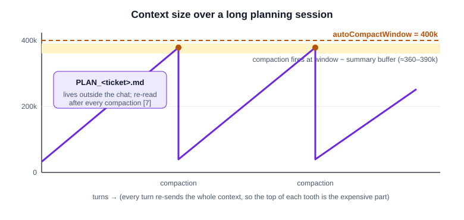

# The Concord workflow

*How a ticket runs. Setup: [SETUP.md](SETUP.md); other workflows: [COMPARISON.md](COMPARISON.md); the exact steps: [plan-then-delegate](../adapters/claude-code/commands/plan-then-delegate.md) and [delegate](../adapters/claude-code/commands/delegate.md).*

## Roles

*Frontier tokens go to judgment, cheap tokens to typing.*

| Role | Model (as shipped) | Paid from |
|---|---|---|
| Planner: plans, tests, small changes, checks | the strongest Claude model, high effort | Claude subscription |
| Implementer of bulky phases | DeepSeek or GLM Flash, free; DeepSeek Flash on Go; then Opus 4.8 | free tier, Go allowance, subscription; `zen-*` credits only after asking |
| Reviewer, once | flash at low risk, Opus 5.5 above | free tier or subscription |
| Approver and committer | you | |

## One ticket, end to end

*Two human gates, tests before code, and failures that name where the work goes back.*

1. One git worktree per ticket (`wt.py new`): shared clones once caused 15 lock collisions and 22 unwanted branch switches.
2. A one-page plan: Done when, Ship, Open questions and phases (executor, risk, files, steps, acceptance commands). `concord.py --lint` checks each delegated phase once: zero-token lines for six defects plan reviews kept rediscovering, then a cheap model's questions.
3. You approve, once every known ambiguity is settled.
4. The planner writes failing tests for the main behaviour; then phases run in passes, not as a chain: pass 1 starts every phase at once at rough quality, bulky ones on free models, each in its own fork; each later pass fixes only the largest gaps the last check found; edge cases, proofs and polish come last. Only real dependencies wait: one writer per file, and a phase waits for the tests it runs.
5. After each pass the planner re-runs only the changed phases' acceptance commands and records PASS or FAIL with a cause.
6. After the last pass, one full revision: every suite and one independent review of the whole diff at its risk tier, at the pull-request gate when the ticket ships by PR. Confirmed BLOCKER, HIGH and MEDIUM findings are fixed and re-reviewed once as a delta; after two rounds you decide.
7. You commit and merge.

## Evidence, not claims

Before each executor run `concord.py` snapshots the tree, backs up in-scope files and hashes the plan and acceptance; it refuses to start when acceptance already passes (the red run) and reports from snapshots, never from the executor's account. Only EXECUTOR failures count as attempts (three, then you decide): 7 of 35 failures in the first ten days. Causes, refusals and exit codes: [README](../README.md#run-a-ticket).

## Review

High risk means untrusted input, scores or thresholds, security, money, data deletion or concurrency; a repository's `Risk floor <tier>: <globs>` notes line raises sensitive paths. A finding needs a reproduction to stay above NOTE. Clean reviews are reused on unchanged files. At the PR gate a review counts at most at its reviewer's rank, so a flash review cannot pass a high-risk pull request without your recorded go-ahead.

*A retired segmented review; its 60,000-character cap and file-group split remain.*

## Token economy

*Compacting at a 400k window keeps every turn below the curve's costliest part.*

DeepSeek Flash runs at effort `high`: in fifteen runs on one hard problem it matched `max` for less.

*Reasoning tokens and correct answers per variant, 15 runs on one problem.*

## Known limits

- File scope is enforced only on OpenCode's edit tools; shell redirection and network use are not mediated, so the in-scope backup is the safety net.
- Failure causes are assigned by the orchestrator that wrote the plans; no second rater has checked them.
- Line budgets (`tests/package_test.sh`) and `/concord:rules-review` keep Concord small; [COMPARISON.md](COMPARISON.md) maps what it lacks.
