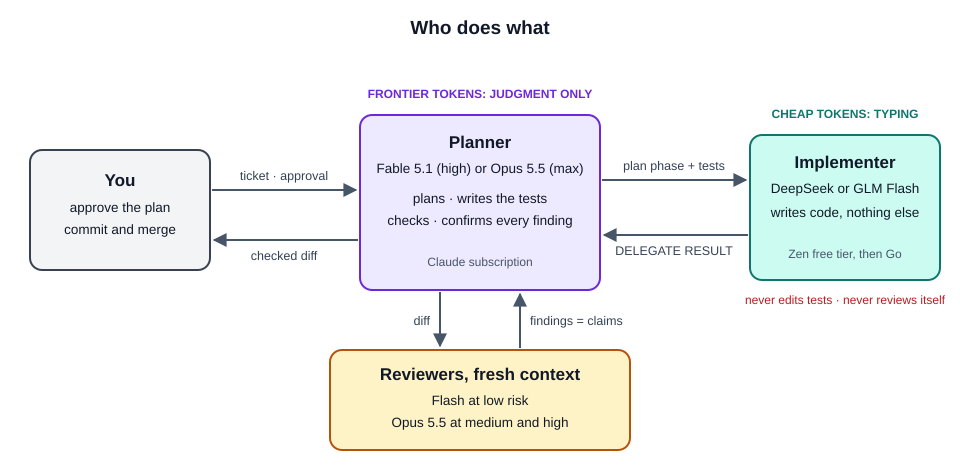
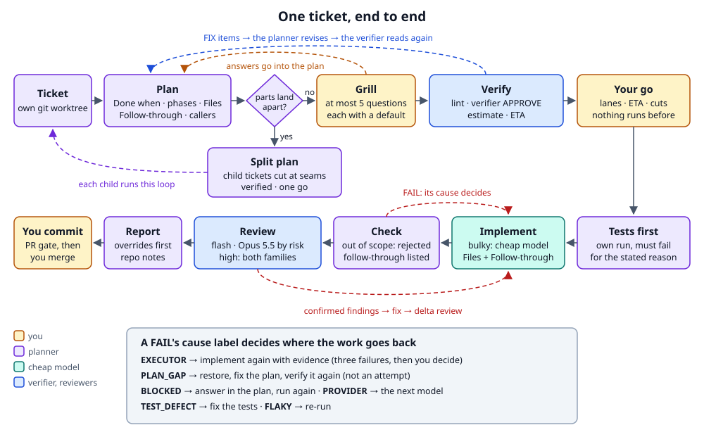
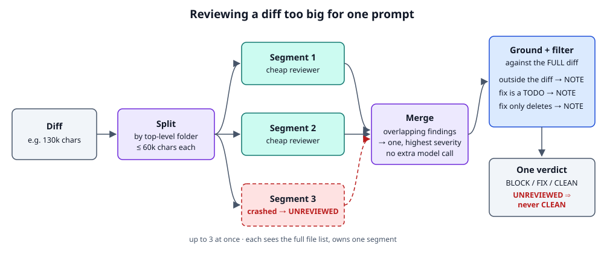
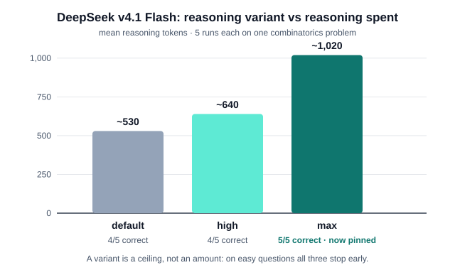

# The Concord workflow

*How a ticket runs, from plan to commit. Installation and configuration: [SETUP.md](SETUP.md). How Concord compares with other workflows and what it learned from them: [COMPARISON.md](COMPARISON.md). The governance model and the evidence are written up in the paper (see Citation in the [README](../README.md)).*

## Roles

Frontier tokens are the scarce resource. Concord spends them where judgment matters, deciding what to build and deciding whether it was built, and nowhere else.


*Frontier tokens go to judgment, cheap tokens to typing. Reviewer output returns as claims the planner must confirm.*

| Role | Model (as shipped) | Effort | Paid from |
|---|---|---|---|
| Planner, test author, verifier | the strongest Claude model available in the session | high or max | Claude subscription |
| Plan check before approval (`--lint`) | DeepSeek v4.1 Flash via OpenCode | high | OpenCode Go allowance |
| Implementer | DeepSeek v4.1 Flash | high | Go allowance; pay-per-token credit (`zen-*`) only after asking |
| Implementer for a "subtle logic" phase, or when Go and Zen are both unavailable | Claude Opus 4.8 (`concord:implementer-opus48`) | high | Claude subscription |
| Reviewers | low risk: Flash; medium: Opus 4.8 only; high: Opus 5.5 only | high | Go allowance or subscription |
| Approver and committer | you | | |

One cheap executor does every implementing phase. A hard phase is split or its tests are tightened; it does not get a heavier model. The choice came from data: a longer phase given to another model once ran for thirty minutes chasing two defective tests and used most of a five-hour allowance window, while DeepSeek Flash was the cheapest adequate model on the boards we checked and the fastest in our runs.

The planner checks its own session before planning. If the session runs a weaker model or a lower effort than the rules name, it says so and asks; an app's per-session picker can silently override the settings file.

## What the dispatcher enforces on every run

`concord.py` is the part that makes the rules hold. For each run it:

- hashes the plan and every file the acceptance commands name, including files under directories they name;
- snapshots the working tree, ignored files included;
- runs the acceptance commands on the untouched tree and refuses to spend tokens when they already pass (the red run, exit 6), unless the phase is marked behaviour-preserving;
- starts the executor with edit permission limited to the phase's `Files:`, and with web access, sub-agents and script-execution tools denied;
- re-runs the acceptance commands afterwards and runs the static checks before and after;
- writes a report whose every field comes from snapshots, hashes and the harness's own usage store, never from the executor's account of itself;
- keeps a per-checkout lock, an append-only ledger of verdicts with causes and a review ledger per run;
- refuses a fourth executor attempt after three EXECUTOR failures (exit 8), a PASS below the phase's review tier (exit 9) and a PASS after an acceptance file changed (exit 7). Each refusal can be overridden only with the user's own words, recorded with `--user-approved`.

Nothing in Concord calls a model API directly. Executors run through OpenCode or, for Claude models, as Claude Code subagents on the subscription, and the dispatcher refuses to send a Claude model through any other harness (exit 5), so a subscription never turns into a metered bill by accident.

Permissions keyed by tool names are not enough. Early on, a read-only pre-flight agent whose rules forbade edits, shell commands and web access was refused a read outside the project, and then fetched the same files from a public code host through a script-execution tool no rule named. Nothing was modified, but the offline guarantee did not hold. The dispatcher has denied such meta-tools outright ever since (`OPENCODE_ALWAYS_DENY` in `concord.py`), and the harness is probed again after every upgrade.

## One ticket, end to end


*Two human gates, tests before code, and a failure that always names where the work goes back.*

1. **One ticket, one git worktree** (`wt.py new <TICKET>`). Parallel sessions sharing one clone produced 15 lock collisions and 22 unwanted branch switches in one measured stretch, before tickets were isolated.
2. **Read cheaply.** Repository notes (`repo-notes/<repo>.md`), the ledger of past plan gaps in this repository (`repo-notes/<repo>.gaps.md`), then only the code the task touches.
3. **Gain table first.** Every item names the metric it should move and by how much; an item that moves nothing is cut before planning. The ticket's row becomes the plan's Outcome block, with a minimal case and guardrails.
4. **Write the plan.** `PLAN_<ticket>.md` from `PLAN_TEMPLATE.md`: phases with exact files, interfaces, input classes, examples, edge cases, acceptance commands, a line budget, an executor and a risk level per phase, and every open question. Plans stay lean: tests, then one executor run for the ticket's code, then a measurement. Split a run only after it fails for being too big; a gap found by review on a green, in-scope diff becomes a sub-phase on the kept diff.
5. **Plan-only review** (`concord.py --lint <phase>`). First the dispatcher prints ACCEPTANCE LINT lines at zero model tokens, for six defects plan reviews kept rediscovering: a count piped into `grep -qx 0` (true on empty input), a string comparison of `wc` output, an acceptance bullet without backticks (never run), a missing file outside `Files:`, a characterization word without the `(characterization)` marker and git inside `$( )` (the Claude Code worktree guard refuses it). Then a cheap model reads the plan and the repository, never the future code, and lists the questions it would need answered, the files it would need, the input classes no acceptance command exercises, and the risks.
6. **Human approval.** Nothing runs before it. Every known ambiguity is settled here; an executor that still meets one may stop once with BLOCKED and its question.
7. **Tests first.** The planner writes them; they must fail on the untouched code, unless the phase preserves behaviour, which then needs a before/after characterization command. Acceptance commands that already pass carry the literal marker `(characterization)`.
8. **Implement.** One executor run per phase, inside the guarantees listed above.
9. **Verify from evidence.** The planner re-runs the acceptance commands and reads the diff of the changed files only. Any of the report's failure lines fails the phase (see below). A planner's own run may edit its plan; any other run that does fails.
10. **Independent review.** Fresh agents that did not write the code, one REVIEW-JSON block each, at the phase's tier. The planner confirms every finding against the diff before acting, and confirmed findings are fixed right away.
11. **Verdict.** PASS or FAIL with a cause, closed in one call together with the review adjudication.
12. **Pull-request gate.** No pull request is called ready before a review of its full diff at its risk tier, on its current head. "Mergeable" on the hosting site is not a review. You commit and merge.

## Commands for one phase

```bash
python3 ~/.claude/concord/concord.py --lint 2 --plan PLAN_x.md --repo .          # plan-only review
python3 ~/.claude/concord/concord.py deepseek-flash 2 --plan PLAN_x.md --repo .  # implement phase 2
python3 ~/.claude/concord/concord.py --review last                               # cheap review (low tier)
python3 ~/.claude/concord/concord.py --review last --packet                      # prompt for an Opus reviewer agent
python3 ~/.claude/concord/concord.py --review-record last --reviewer concord:reviewer-opus48 --file review.txt
python3 ~/.claude/concord/concord.py --close-round last --adopt F1,F3 --wrong "F2=why" \
    --verdict-result PASS --note "..."                                             # adjudication + verdict
python3 ~/.claude/concord/concord.py --stats                                     # rounds per phase, causes, spend
```

A planner or Claude-subagent phase is bracketed instead: `--begin <phase> --label <name>`, the work, then `--end <run id>`.

## Reading a report

Every report starts with `DELEGATE RESULT <run id>` and uses fixed vocabulary. These lines fail a phase:

| Line | Meaning |
|---|---|
| `OUT OF SCOPE` | a file outside the phase's `Files:` changed |
| `DELETED` | a file was removed |
| `STAGED BY EXECUTOR` | the executor touched the git index |
| `PLAN FILE MODIFIED` | an executor edited the plan |
| `OVER BUDGET` | more changed lines than the phase's budget |
| `INTERFACE MISMATCH` | a signature listed under Interfaces is not in the diff verbatim |
| `CHARACTERIZATION CHANGED` | a behaviour-preserving phase changed its characterized output |
| `ACCEPTANCE FILES CHANGED` | a file the acceptance commands read was changed, removed or added |
| `STATIC NEW` | the static checks report a problem that was not there before |
| `ACCEPTANCE AFTER RUN: 0/N pass` | nothing passes after the run |
| `EXECUTOR BLOCKED` | the executor stopped with a question instead of guessing; record FAIL --cause BLOCKED, answer it in the plan, re-run |

A run that exits successfully without changing a file is flagged `NO CHANGES`, the early-completion case. If the planner records a FAIL without a cause after every acceptance command passed, the dispatcher suggests TEST_DEFECT: the tests did not catch what the planner caught.

## Review tiers and findings

Review depth follows risk. Low-risk phases get a cheap review; medium-risk phases one Opus 4.8 round; high-risk phases an Opus 5.5 round plus property tests and a mutation probe (`--mutate`). A phase is high risk whenever it parses untrusted input, sets scores or thresholds, or touches security, money, data deletion or concurrency. The tiers earned their keep early: one Opus 5.5 round caught a not-a-number bug the cheap reviewer had only flagged, raised it to a blocker, and showed that the cheap reviewer's suggested fix would itself overflow on very large integers. A repository can raise the floor for sensitive paths with a `Risk floor <tier>: <globs>` line in its notes: a change to a matching non-test file then needs that tier's reviewer.

Reviewer output is a claim, not evidence. The dispatcher downgrades to a NOTE, with the reason, any finding located outside the diff (three lines of slack), any fix that is only a to-do marker and any fix that only deletes code. After confirming a review the planner records what happened to each finding (adopted, wrong, declined); findings carry ledger ids (F1, F2, ...) that bind later rounds, so the choice of reviewer per tier rests on data. A repeated false finding is often a harness bug rather than a model failure: a cheap reviewer once reported a "committed cache" in five rounds because the dispatcher had passed it every file a run created, caches included. Reviews now leave out generated files.

A run diff over the review cap (60,000 characters) is refused with the file groups to review separately: `--review <run> --files <globs>` (and `--exclude`), the same as `--review-pr`. A delta review after a fix shows the fix with the touched functions as context; a fix diff over the cap needs a full review.


*The segmented review as first built, and then retired: it added about 400 lines that no diff in daily use needed. The cap and the file-group split remain.*

## Verdicts and failure causes

Every FAIL names a cause, so the right thing gets fixed; a PASS may carry SPEC_GAP:

- **EXECUTOR**: the implementer got it wrong. This is the only cause that counts as an attempt; three in a row stop the phase until the user decides. The retry carries structured feedback: evidence, suspected files, the change needed.
- **PLAN_GAP**: the plan was missing something and the diff cannot stand. Restore, fix the plan, re-run; the gap goes into the repository's gap log, one line, which `--lint` asks of every later phase.
- **TEST_DEFECT**: the tests were wrong. Fix the tests.
- **FLAKY**: the environment failed.
- **PROVIDER**: the model provider refused or limited the run.
- **BLOCKED**: the executor stopped with a question instead of guessing. Answer it in the plan and re-run; not an attempt; a second BLOCKED on the same phase is a PLAN_GAP.
- **SPEC_GAP** (on a PASS): a review found a case the plan never specified while acceptance was green and the scope clean. The diff stays; a sub-phase N.1 adds the missing test and change, and its review reads only that change.

Most failures are plan gaps, not executor mistakes: in the first ten days only 7 of 35 failures were the executor's. That is why the plan gets a lint, a review of its own and a ledger of past gaps.

## Keeping Concord small

Every file carries a line budget that `tests/package_test.sh budgets` pins. `/concord:rules-review` is the weekly ten-minute pass that keeps them there and retires rules that produced no change in a month. Every new rule starts with one question: general or repository-specific? Repository-specific facts go to repository notes, general ones to Concord, and changes to Concord itself go through a staging copy, the regression suites, an independent review and a line budget, like any other change.

## Token economy


*Compacting at a 400k window keeps every turn below the most expensive part of the curve; the plan file survives each compaction.*

- **Auto-compact at a 400k window.** Claude Code's per-model `autoCompactWindow` is set to 400,000 tokens for the planner models (`adapters/claude-code/settings.snippet.json`), so compaction fires at the window minus a summary buffer, roughly 360k to 390k. Every turn re-sends the whole context, so the last few hundred thousand tokens of a long session are the most expensive ones. The plan file, with its Outcome and Handoff blocks, lives outside the conversation, and the planner re-reads it after every compaction.
- **Terse prose wherever only agents read it.** Chat, agent progress notes and executor reports are terse: fragments, abbreviations, no filler, with code, paths, commands, numbers and error text kept exact (`CONTRACT.md` rule 12). Plans, documents for readers, commit messages and pull-request text stay in full prose.
- **Reasoning effort pinned for the cheap model.** OpenCode offers `default`, `low`, `high` and `max` reasoning variants for DeepSeek v4.1 Flash. A variant sets a ceiling, not an amount: on an easy question every level stops early. Fifteen runs on one harder combinatorics problem showed `high` correct as often as `max` at lower cost, so Concord pins `high` (the `#high` suffix in `models.conf`) and sizes phases so that no executor needs the ceiling.


*Mean reasoning tokens and correct answers per variant, 15 runs on one problem.*

## Known limits

- File scope is enforced only on OpenCode, and only for its edit tools; shell redirection is not mediated, and neither is network use through the shell. On other harnesses scope is reported after the fact. The backup of in-scope files is the safety net.
- Failure causes are assigned by the same orchestrator that wrote the plans and tests. Until a second rater checks a sample, "plans, not executors, cause most failures" is a well-supported hunch.
- Concord's governance model has six layers of authority; this repository builds the evidence and execution layers and only part of the constitution, domain and contract layers. There is no machine-checked contract registry, no path reservation before parallel dispatch, and evidence is not yet bound to a hash of the checked state. [COMPARISON.md](COMPARISON.md) maps the layers.
